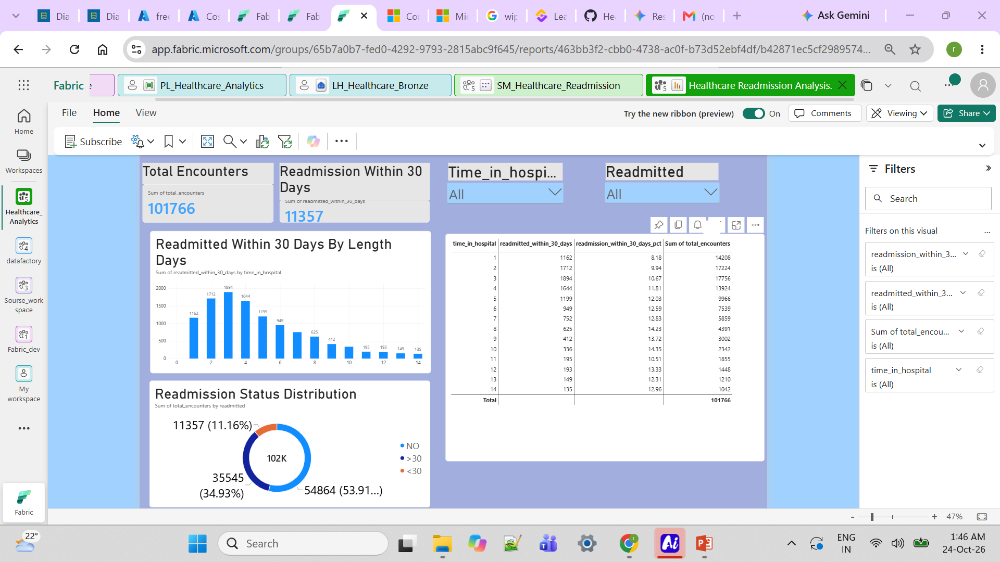

# Healthcare-analytics-microsoft-fabric
End-to-end healthcare data engineering and analytics using Microsoft Fabric, PySpark, SQL, Lakehouse medallion architecture, and Power BI to transform clinical encounter data into actionable healthcare insights.
# Healthcare Data Engineering and Analytics with Microsoft Fabric

## Project Overview

This project demonstrates an end-to-end healthcare data engineering and analytics workflow using Microsoft Fabric. Using a publicly available hospital diabetes dataset, the project will transform raw clinical encounter data into clean, structured, and analytics-ready datasets.

The goal is to demonstrate practical skills in healthcare data analysis, data engineering, SQL, PySpark, data quality, and business intelligence.

## Project Objectives

- Ingest healthcare data into a Lakehouse.
- Build a Medallion Architecture with Bronze, Silver, and Gold layers.
- Clean, standardize, and validate clinical encounter data.
- Use SQL and PySpark to transform and analyze healthcare data.
- Develop healthcare KPIs and analytical datasets.
- Present insights through a Power BI dashboard.
- Apply responsible data handling and documentation practices.

## Technology Stack

- Microsoft Fabric
- Fabric Lakehouse
- PySpark and Python
- SQL
- Power BI
- GitHub

## Dashboard Preview



## Key Findings & Business Insights

- **Total Encounters:** 101,766 hospital encounters were analyzed.
- **30-Day Readmissions:** 11,357 encounters resulted in readmission within 30 days, representing **11.16%** of all encounters.
- **Readmission Categories:** 53.91% had no recorded readmission, 34.93% were readmitted after 30 days, and 11.16% were readmitted within 30 days.
- **Length-of-Stay Analysis:** The dashboard enables comparison of encounter volumes and 30-day readmissions across hospital stays of different lengths.
- **Business Value:** These insights can help healthcare teams explore readmission patterns and identify areas for further investigation in discharge planning and follow-up care.

**Note:** These findings describe historical data and do not establish that length of stay causes readmission.

## Dataset

**Diabetes 130-US Hospitals for Years 1999–2008**

Source: [UCI Machine Learning Repository](https://archive.ics.uci.edu/dataset/296/diabetes+130-us-hospitals+for+years+1999-2008)

The dataset contains hospital encounter information relating to diabetes care, including patient demographics, diagnoses, laboratory procedures, medications, length of stay, and readmission outcomes.

The dataset is intended for educational and analytical purposes. This project will document the source and follow its applicable licensing and attribution requirements.

## Architecture

The project will follow a Medallion Architecture:

1. **Bronze — Raw Data:** Ingest and preserve the source data.
2. **Silver — Cleaned Data:** Standardize fields, handle missing values, and validate data quality.
3. **Gold — Analytics:** Create curated tables and healthcare KPIs for reporting.
4. **Power BI — Visualization:** Present trends and findings in an interactive dashboard.

## Planned Analysis

The analysis will explore questions such as:

- What proportion of hospital encounters result in readmission?
- How does length of stay vary across patient groups?
- Which clinical and encounter characteristics are associated with readmission?
- How do medication and laboratory procedure patterns vary across encounters?
- What data quality issues need to be addressed before analysis?

These analyses will be exploratory and will not establish causation or provide clinical recommendations.

## Planned Repository Structure

```text
healthcare-analytics-microsoft-fabric/
├── README.md
├── data/
│   └── DATA_SOURCE.md
├── notebooks/
│   ├── 01_bronze_ingestion.ipynb
│   ├── 02_silver_transformation.ipynb
│   └── 03_gold_analytics.ipynb
├── sql/
│   └── healthcare_kpis.sql
├── powerbi/
│   └── screenshots/
└── docs/
    ├── architecture.md
    └── data_dictionary.md
```

## Data Governance

- Use a publicly available dataset and document its source.
- Do not publish patient-identifying information or sensitive data.
- Avoid uploading the dataset itself to GitHub unless redistribution is explicitly permitted.
- Document assumptions, transformations, and data quality limitations.
- Interpret findings responsibly and avoid unsupported clinical conclusions.

## Project Status

**Core analytics and dashboard completed** — Microsoft Fabric data processing, Gold-layer analytics, validation, and the Power BI dashboard are built. GitHub documentation and final repository polish are in progress.

## About the Author

I am a clinical dentist with 10 years of experience, transitioning into healthcare data analytics. This project combines my clinical background with practical data engineering and analytics skills to explore how healthcare data can support operational insights and informed decision-making.

## References

- [UCI Machine Learning Repository — Diabetes 130-US Hospitals](https://archive.ics.uci.edu/dataset/296/diabetes+130-us-hospitals+for+years+1999-2008)
- [Microsoft Fabric documentation](https://learn.microsoft.com/en-us/fabric/)

 ## Limitations

- This analysis is based on historical hospital encounter data and may not represent every healthcare setting.
- Readmission patterns show associations, not proof of causation.
- The dashboard summarizes aggregate results; patient-level clinical review would be needed before making care decisions.
- The findings are intended for analytical and educational purposes, not as a clinical decision-making tool.

 ## Future Enhancements

- **Advanced Readmission Analysis:** Explore additional factors associated with 30-day readmissions.
- **Interactive Dashboard Improvements:** Improve slicer interactions and cross-filtering between report visuals.
- **Predictive Analytics:** Explore machine learning models to estimate readmission risk, subject to appropriate validation.
- **Automated Data Refresh:** Extend the pipeline to support scheduled data refresh and validation checks.
- **Deeper Clinical Insights:** Investigate patterns by patient demographics and other available clinical variables, where appropriate.
